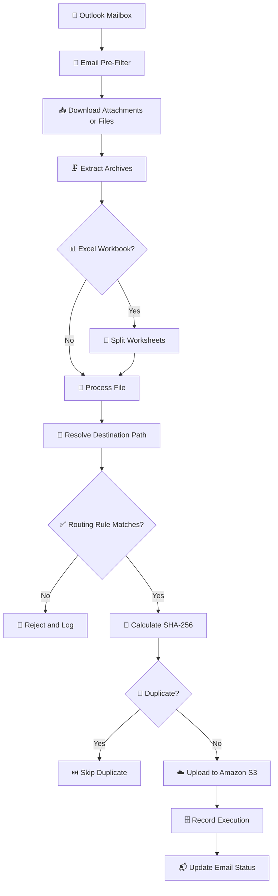

# 📧 Email-to-S3 Pipeline

<div align="center">

### 🚀 Automated Email Attachment Ingestion to Amazon S3

A Python-based ETL pipeline for processing email attachments, applying routing rules, detecting duplicates, and uploading files to Amazon S3.

[](https://www.python.org/downloads/)
[](https://www.postgresql.org/)
[](https://aws.amazon.com/s3/)

</div>

---

## 📌 Overview

Email-to-S3 Pipeline automates the ingestion of email attachments and supported download links into Amazon S3. It aims to reduce manual file handling through configurable routing, duplicate detection, processing automation, and execution tracking.

## ✨ Features

### ⚙️ Core Capabilities

- 📥 **Multi-Source Ingestion:** Processes email attachments and supported download URLs.
- 🔍 **Content-Based Deduplication:** Uses SHA-256 hashing to identify duplicate content.
- 📊 **Excel Processing:** Supports splitting worksheets into individual CSV files.
- 🧭 **Rule-Based Routing:** Uses configurable rules to determine destination paths.
- ⚡ **Concurrent Processing:** Supports parallel email processing.
- 🗜️ **Archive Extraction:** Supports ZIP/GZIP processing where configured.

### 🛡️ Reliability & Operations

- 🗄️ **PostgreSQL Tracking:** Stores execution information and audit records.
- 🔁 **Idempotent Processing:** Helps prevent duplicate file processing.
- 📈 **Execution Metrics:** Tracks processing outcomes and rejection reasons.
- 📬 **Email Notifications:** Supports Amazon SES notifications where configured.
- 🧹 **Temporary File Cleanup:** Helps manage temporary processing files.
- 🔐 **Security Controls:** Encourages secure configuration and credential protection.

---

## 🏗️ Architecture



---

## 🚀 Getting Started

### 📋 Prerequisites

| Component | Requirement |
|---|---|
| 🐍 Python | 3.9 or later, subject to dependency compatibility |
| 📦 pip | Python package installer |
| 🗄️ PostgreSQL | Required if database tracking is enabled |
| ☁️ AWS Account | Required for S3 access |
| 🔑 Microsoft Graph/Azure AD | Required if used for Outlook integration |

### 📥 Installation

**1. Clone the repository**

```bash
git clone https://github.com/prakashpandey16/email-to-s3-pipeline.git
cd email-to-s3-pipeline
```

**2. Create a virtual environment**

🪟 **Windows Command Prompt**

```cmd
python -m venv .venv
.venv\Scripts\activate
```

🐧 **Linux/macOS**

```bash
python -m venv .venv
source .venv/bin/activate
```

**3. Install dependencies**

```bash
python -m pip install --upgrade pip
pip install -r requirements.txt
```

**4. Configure required services** ⚙️

See the configuration section below before running the pipeline.

---

## ⚙️ Configuration

Configure the services required by your deployment:

- 📧 **Email Integration:** Microsoft Graph/Azure AD application settings, if applicable.
- ☁️ **Amazon S3:** Target bucket, region, and appropriate IAM permissions.
- 🗄️ **PostgreSQL:** Database connection settings, if database tracking is enabled.
- 📬 **Notifications:** Amazon SES configuration, if notifications are enabled.
- 🧭 **Routing Rules:** File matching and destination path rules.

### 🔐 Security Checklist

- 🚫 Never commit AWS access keys, passwords, API tokens, or private keys.
- 🛡️ Exclude `.env` files, local configuration files, and browser session data from version control.
- 🔒 Apply least-privilege permissions to AWS resources.
- 🧾 Avoid logging secrets or sensitive email content.
- 🔄 Rotate credentials immediately if they are exposed.

---

## ▶️ Usage

The exact commands depend on the entry points implemented in your repository.

If `main.py` is the pipeline entry point, run:

```bash
python main.py
```

If a batch runner exists, check its supported arguments before running it:

```bash
python main_batch_run.py --help
```

> 💡 Confirm that the scripts and arguments above exist in your project before relying on these commands.

---

## 📊 Monitoring

Depending on the implementation, useful operational metrics may include:

- 📬 Emails scanned
- ☁️ Files uploaded
- ⏭️ Duplicate files skipped
- 🏷️ Files rejected due to filename mismatch
- 📄 Files rejected by extension policy
- ⚠️ Failed processing attempts

Verify metric names and availability against the actual implementation.

---

## 📁 Project Structure

The following is a representative structure. Update it to match the actual files in your repository before publishing.

```text
email-to-s3-pipeline/
├── auth/                # 🔑 Authentication integrations
├── config/              # ⚙️ Application configuration
├── connectors/          # 🔌 Email, S3, and notification clients
├── processors/          # 🧰 Downloading and file processing
├── sql_script/          # 🗄️ Database schema scripts
├── tests/               # 🧪 Automated tests
├── utils/               # 🛠️ Shared utilities
├── main.py              # 🚀 Pipeline entry point
├── requirements.txt     # 📦 Python dependencies
└── README.md            # 📘 Project documentation
```

---

## 🧑‍💻 Development & Contributing

1. 🌱 Create a feature branch:

   ```bash
   git checkout -b feature/your-feature
   ```

2. 🛠️ Implement and test your changes.
3. 🧹 Follow Python style conventions.
4. 📝 Update documentation when necessary.
5. 📤 Commit your changes and open a pull request.

---

## 📄 License

Choose the license that applies to this project. Use the MIT License only if you have the right to distribute the code under MIT and include a valid `LICENSE` file.

---

## 💬 Support

🐛 For bugs or suggestions, open an issue in this repository:

[🔗 GitHub Issues](https://github.com/prakashpandey16/email-to-s3-pipeline/issues)

---

<div align="center">

### 💙 Built with Python, PostgreSQL, and AWS

[⬆️ Back to Top](#-email-to-s3-pipeline)

</div>
